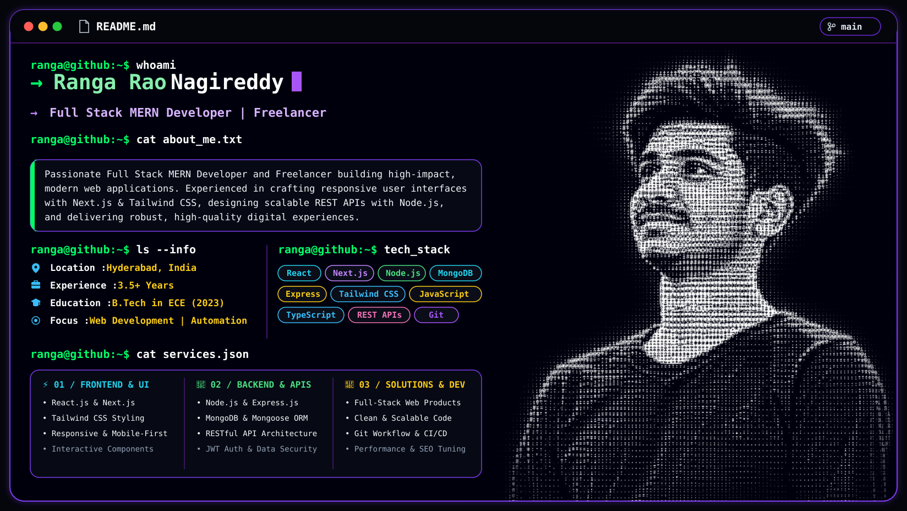
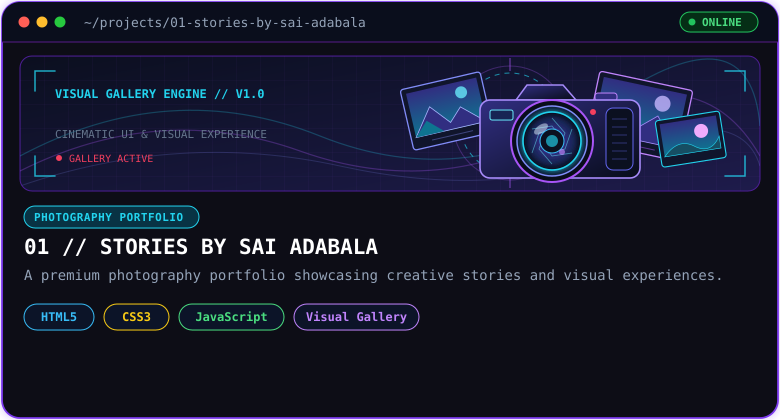
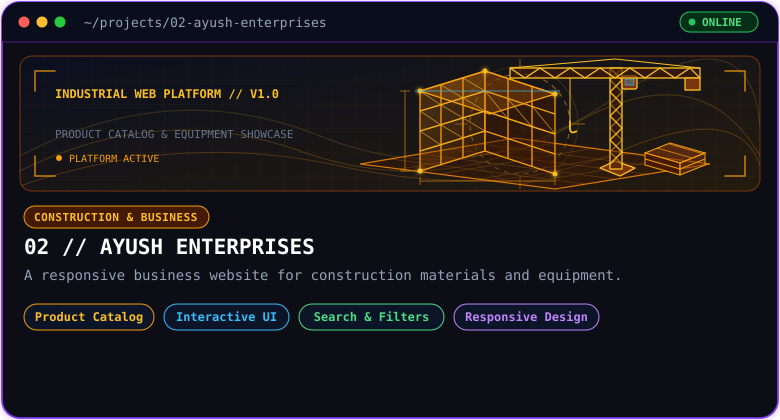
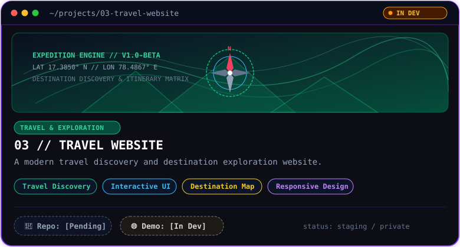
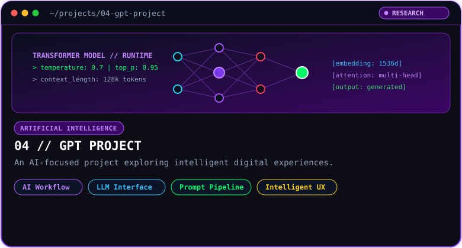

<div align="center">

<!-- ======================================================================= -->
<!-- MASTER HERO TERMINAL BANNER                                              -->
<!-- Visual reproduction of neon terminal with ASCII portrait & stats        -->
<!-- 1648 x 928 px hardcoded SVG with editable text tags & ASCII portrait    -->
<!-- ======================================================================= -->


<br/><br/>

<!-- ======================================================================= -->
<!-- INTERACTIVE CONTACT BUTTONS                                              -->
<!-- Wrapped in genuine markdown/HTML anchor links for GitHub functionality   -->
<!-- ======================================================================= -->
<p align="center">
  <a href="https://github.com/Naidu-07" target="_blank">
    
  </a>&nbsp;&nbsp;
  <a href="https://linkedin.com/in/YOUR-LINKEDIN-HANDLE" target="_blank">
    
  </a>&nbsp;&nbsp;
  <a href="https://yourportfolio.com" target="_blank">
    
  </a>&nbsp;&nbsp;
  <a href="mailto:your-email@example.com">
    
  </a>
</p>

</div>

<br/>

<!-- ======================================================================= -->
<!-- SECTION HEADING: FEATURED PROJECTS                                      -->
<!-- ======================================================================= -->
```bash
ranga@github:~$ ls ./featured-projects
```

<!-- 2x2 BALANCED PROJECT SHOWCASE GRID -->
<table border="0" cellpadding="0" cellspacing="12" width="100%">
  <tr>
    <td width="50%" valign="top">
      <a href="https://storiesbysaiadabala.github.io/storiesbysaiadabala/" target="_blank">
        
      </a>
      <p align="center">
        <a href="https://github.com/storiesbysaiadabala/storiesbysaiadabala" target="_blank"><code>📁 Repository ↗</code></a>
        &nbsp;&nbsp;•&nbsp;&nbsp;
        <a href="https://storiesbysaiadabala.github.io/storiesbysaiadabala/" target="_blank"><code>🌐 Live Demo ↗</code></a>
      </p>
    </td>
    <td width="50%" valign="top">
      <a href="https://naidu-07.github.io/ayush-enterprises/" target="_blank">
        
      </a>
      <p align="center">
        <a href="https://github.com/Naidu-07/ayush-enterprises" target="_blank"><code>📁 Repository ↗</code></a>
        &nbsp;&nbsp;•&nbsp;&nbsp;
        <a href="https://www.ayushenterprises.net" target="_blank"><code>🌐 Live Demo ↗</code></a>
      </p>
    </td>
  </tr>
  <tr>
    <td width="50%" valign="top">
      <!-- 03 Travel Website (Placeholder - replace href with your real URL when ready) -->
      <a href="https://github.com/Naidu-07">
        
      </a>
      <p align="center">
        <code>📁 Repo: [Pending Release]</code>
        &nbsp;&nbsp;•&nbsp;&nbsp;
        <code>🌐 Demo: [In Development]</code>
      </p>
    </td>
    <td width="50%" valign="top">
      <!-- 04 GPT Project (Placeholder - replace href with your real URL when ready) -->
      <a href="https://github.com/Naidu-07">
        
      </a>
      <p align="center">
        <code>📁 Repo: [Pending Release]</code>
        &nbsp;&nbsp;•&nbsp;&nbsp;
        <code>🌐 Demo: [In Development]</code>
      </p>
    </td>
  </tr>
</table>

<br/>

<!-- ======================================================================= -->
<!-- TERMINAL FOOTER                                                         -->
<!-- ======================================================================= -->
```bash
ranga@github:~$ echo "Thanks for visiting!"
Thanks for visiting!
```

---